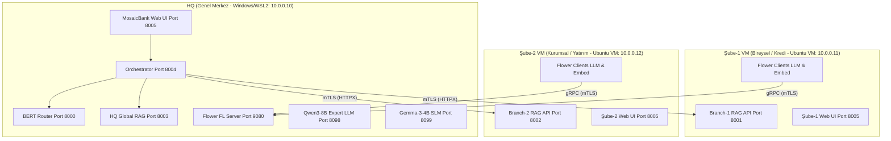

# MOSAIC-v2 Teknik Dağıtım ve İşletim Kılavuzu

Bu kılavuz, **MOSAIC-v2** (Turkish Finance Federated RAG) mimarisinin **HQ (Merkez Sunucu - Windows/WSL2)** ve **Branch VMs (Şube Sanal Makineleri - VMware Ubuntu)** üzerinde sıfır hata ile kurulması, ağ yapılandırması ve tek komutla ayağa kaldırılması adımlarını açıklamaktadır.

---

## 1. Mimari ve Ağ Topolojisi

MOSAIC-v2, iki bağımsız dağıtık mekanizma ile çalışır:
1. **Gerçek Zamanlı Çapraz Şube RAG Sorgulama (Port 8001 / 8002 / 8003):** 
   HQ Orchestrator, gelen sorguyu analiz eder. Sorgu şube özelinde ise ilgili şubenin RAG servisine (Şube-1: Port 8001, Şube-2: Port 8002) mTLS üzerinden sorgu gönderir. **Ham PDF şube sanal makinesinden ASLA çıkmaz**; sadece anonim metin parçacıkları HQ'ya döner.
2. **Periyodik Federatif Öğrenme (Flower - Port 9080):** 
   Şubeler kendi yerel verileriyle yerel modelleri eğitir. Yalnızca Diferansiyel Gizlilik (DP-SGD) eklenmiş gürültülü gradyanlar merkeze (HQ) iletilerek model ağırlıkları federatif olarak iyileştirilir.



---

## 2. Port ve Düğüm Haritası (Kritik Referans)

Ağdaki port çakışmalarını ve yanlış yönlendirmeleri önlemek için sistemdeki port standardı şöyledir:

| Düğüm | Görev / Servis | Port | Protokol | Açıklama |
| :--- | :--- | :--- | :--- | :--- |
| **HQ** | BERT Router | `8000` | HTTP | Soru karmaşıklığı sınıflandırma |
| **HQ** | HQ Global RAG | `8003` | HTTP/mTLS | Global mevzuat ChromaDB (22k chunk) |
| **HQ** | Orchestrator API | `8004` | HTTP / SSE | Çapraz yönlendirme & Token akışı |
| **HQ** | Web UI & API Gateway | `8005` | HTTP | MosaicBank HQ Arayüzü |
| **HQ** | Qwen3-8B Expert | `8098` | HTTP | Derin finansal analiz LLM |
| **HQ** | Gemma-3-4B SLM | `8099` | HTTP | Basit finans / Chitchat SLM |
| **HQ** | Flower FL Server | `9080` | gRPC/mTLS | Model federasyon sunucusu |
| **Şube-1 VM** | Şube-1 RAG API | **`8001`** | HTTP/mTLS | Bireysel/Kredi ChromaDB (7.8k chunk) |
| **Şube-1 VM** | Şube-1 Web UI | `8005` | HTTP | İzole Şube-1 Arayüzü |
| **Şube-2 VM** | Şube-2 RAG API | **`8002`** | HTTP/mTLS | Kurumsal/Yatırım ChromaDB (14.7k chunk) |
| **Şube-2 VM** | Şube-2 Web UI | `8005` | HTTP | İzole Şube-2 Arayüzü |

---

## 3. Ön Gereksinimler ve Hızlı Kurulum

### A. Şube Sanal Makineleri İçin Sıfır Baş Ağrısı (Zero-Config)
1. **Node.js / npm Kurulumu GEREKMEZ:** 
   Frontend üretim derlemesi (`frontend/dist/`) ve TLS sertifikaları (`backend/certs/`) git reposunda hazır olarak izlenmektedir. Sanal makinelerde npm install veya build yapılmasına gerek yoktur.
2. **Hafif Bağımlılık Seti:** 
   Sanal makinelerde GPU veya PyTorch derleme gereksinimlerini minimuma indiren `requirements_client.txt` hazırlanmıştır.

```bash
# Sanal Makinede (Ubuntu):
git pull origin main

# Sanal ortamı oluşturun ve aktif edin:
python3 -m venv .venv
source .venv/bin/activate

# Şube hafif gereksinimlerini yükleyin:
pip install --upgrade pip
pip install -r requirements_client.txt
```

---

## 4. Şube-1 VM Başlatma (Bireysel / Kredi Bankacılığı)

* **IP:** `10.0.0.11`
* **RAG Portu:** `8001`
* **Koleksiyon:** `branch_01`

### Adım 1: `.env` Dosyası
Şube-1 VM proje kök dizininde `.env` dosyasını oluşturun veya güncelleyin:

```ini
MOSAIC_ENV=branch
BRANCH_ID=branch_01

# RAG Servis Ayarları
BRANCH_RAG_PORT=8001
BRANCH_RAG_BIND=0.0.0.0
CHROMADB_PATH=data/chromadb/branch_01

# HQ Bağlantı Ayarları
SERVER_HOST=10.0.0.10
FL_SERVER_ADDRESS=10.0.0.10:9080
ORCHESTRATOR_URL=http://10.0.0.10:8004

# Güvenlik & TLS
RAG_TLS_VERIFY=true
RAG_CA_CERT_PATH=backend/certs/ca.crt
ENABLE_PII_LOGGING=false

# Differential Privacy (DP-SGD)
DP_EPSILON=1.0
DP_DELTA=1e-5
DP_SENSITIVITY=1.0
```

### Adım 2: Tek Komutla Servisleri Başlatma
Şube-1 VM üzerinde ortamı, `.env` senkronizasyonunu ve tüm servisleri tek bir hamlede başlatmak için özel başlatıcı scriptini çalıştırabilirsiniz:

```bash
# Otomatik venv aktivasyonu, .env.branch1 senkronizasyonu ve başlatma:
chmod +x start_vm1.sh
./start_vm1.sh

# Veya python launcher ile doğrudan:
python scripts/launcher.py --branch1 --all

# Servislerin durumunu kontrol etmek için:
python scripts/launcher.py --branch1 --status

# Servisleri durdurmak için:
python scripts/launcher.py --branch1 --stop
```

---

## 5. Şube-2 VM Başlatma (Kurumsal / Yatırım Bankacılığı)

* **IP:** `10.0.0.12`
* **RAG Portu:** `8002`
* **Koleksiyon:** `branch_02`

### Adım 1: `.env` Dosyası
Şube-2 VM proje kök dizininde `.env` dosyasını oluşturun veya güncelleyin:

```ini
MOSAIC_ENV=branch
BRANCH_ID=branch_02

# RAG Servis Ayarları
BRANCH_RAG_PORT=8002
BRANCH_RAG_BIND=0.0.0.0
CHROMADB_PATH=data/chromadb/branch_02

# HQ Bağlantı Ayarları
SERVER_HOST=10.0.0.10
FL_SERVER_ADDRESS=10.0.0.10:9080
ORCHESTRATOR_URL=http://10.0.0.10:8004

# Güvenlik & TLS
RAG_TLS_VERIFY=true
RAG_CA_CERT_PATH=backend/certs/ca.crt
ENABLE_PII_LOGGING=false

# Differential Privacy (DP-SGD)
DP_EPSILON=1.0
DP_DELTA=1e-5
DP_SENSITIVITY=1.0
```

### Adım 2: Tek Komutla Servisleri Başlatma
Şube-2 VM üzerinde ortamı, `.env` senkronizasyonunu ve tüm servisleri tek bir hamlede başlatmak için özel başlatıcı scriptini çalıştırabilirsiniz:

```bash
# Otomatik venv aktivasyonu, .env.branch2 senkronizasyonu ve başlatma:
chmod +x start_vm2.sh
./start_vm2.sh

# Veya python launcher ile doğrudan:
python scripts/launcher.py --branch2 --all

# Servislerin durumunu kontrol etmek için:
python scripts/launcher.py --branch2 --status

# Servisleri durdurmak için:
python scripts/launcher.py --branch2 --stop
```

---

## 6. HQ (Ana Merkez - Windows / WSL2) Başlatma

HQ tarafında `.env` dosyanızda şube portlarının güncel olduğundan emin olun:

```ini
# .env (HQ)
MOSAIC_ENV=hq
SERVER_HOST=10.0.0.10
HQ_IP=10.0.0.10

HQ_LLM_URL=http://localhost:8098
BRANCH_LLM_URL=http://localhost:8099
HQ_RAG_URL=http://localhost:8003
ROUTER_URL=http://localhost:8000
ORCHESTRATOR_URL=http://localhost:8004

# Şube RAG Erişim IP ve Portları
BRANCH1_RAG_URL=http://10.0.0.11:8001
BRANCH2_RAG_URL=http://10.0.0.12:8002

FL_SERVER_ADDRESS=0.0.0.0:9080
FL_MIN_BRANCHES=2
FL_MIN_CLIENTS=2
```

Tüm HQ servislerini (LLM'ler dahil) tek komutla başlatmak için:
```bash
python scripts/launcher.py --hq --all
```

---

## 7. Ağ ve Güvenlik Duvarı Yapılandırması

VM'lerin HQ ile kesintisiz haberleşebilmesi için:

### A. VMware Ağ Ayarı (Bridged Networking)
1. VMware Player / Workstation üzerinde VM ayarlarına girin.
2. **Network Adapter** ayarını **Bridged: Connected directly to the physical network** yapın.
3. `ip a` çıktısında sanal makinelerin `10.0.0.x` bloğundan IP aldığını doğrulayın.

### B. Ubuntu Güvenlik Duvarı (UFW)
Sanal makinelerde ilgili portlara izin verin:
```bash
# Şube-1 VM üzerinde:
sudo ufw allow 8001/tcp
sudo ufw allow 8005/tcp
sudo ufw reload

# Şube-2 VM üzerinde:
sudo ufw allow 8002/tcp
sudo ufw allow 8005/tcp
sudo ufw reload
```

---

## 8. Sık Karşılaşılan Sorunlar ve Çözümleri (Troubleshooting)

| Sorun | Kök Neden | Çözüm |
| :--- | :--- | :--- |
| `Address already in use (Errno 98)` | Eski bir uvicorn veya python süreci arka planda asılı kalmış. | `python scripts/launcher.py --stop` çalıştırın veya `pkill -9 -f backend_api.py` uygulayın. |
| `PermissionError: /home/<user>/...` | Farklı kullanıcı adına sahip VM'de hardcoded dosya yolu aranması. | Proje otomatik olarak self-healing moduna geçer; `.env` içine `CHROMADB_PATH=data/chromadb/branch_01` yazın. |
| `importlib` veya dependency warning | VM'de torch/sentence-transformers yüklemesinin CLI kontrolünü yavaşlatması. | Başlatıcıya `--skip-dep-check` bayrağı ekleyin: `python scripts/launcher.py --branch1 --all --skip-dep-check`. |
| Dağıtık Ağ Durumu modalında "Çevrimdışı (Timeout)" | VM kapalı, UFW engelliyor veya IP/port eşleşmiyor. | `curl -I http://10.0.0.11:8001/health` ile erişilebilirliği test edin. |
