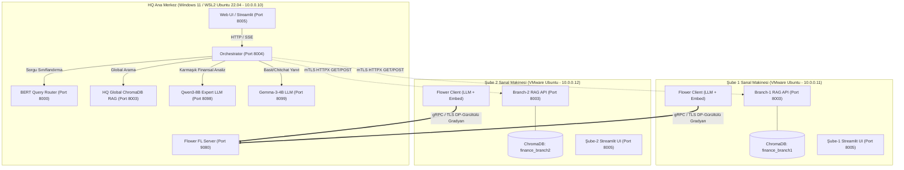

# MOSAIC-v2: Sistem Mimarisi, Dağıtım Kılavuzu ve Teknik El Kitabı

>  **Doğrulama notu (2026-10-14):** Bu belgedeki TR-MMLU (RAG ile %72), BIST duygu (F1 0.79 / 0.8997), "%100 engellendi" ve H1–H3 "doğrulandı" ifadeleri depodaki ham çıktılarla yeniden üretilemedi. "BIST" veri seti KAP/BIST değil genel alan yorumlarıdır (`winvoker`), "TR-MMLU" ise `malhajar/mmlu-tr` çevirisidir. Doğrulanmış durum için bkz. `docs/HIPOTEZ_DOGRULAMA_RAPORU.md`.
**Türkçe Finans İçin Dağıtık Federe RAG ve Çok Katmanlı Yapay Zeka Danışman Mimarisi**

---

## 1. Giriş ve Yönetici Özeti (Introduction & Executive Summary)

### 1.1. Projenin Amacı ve Kapsamı
**MOSAIC-v2**, Türkiye bankacılık ve finans sektörü regülasyonlarına (özellikle **KVKK** ve **BDDK** veri yerelliği kurallarına) tam uyumlu, düşük donanım kaynaklı uç noktalarda (şube sanal makineleri) ve merkezi genel müdürlükte (HQ) çalışmak üzere tasarlanmış **dağıtık ve federe RAG (Retrieval-Augmented Generation)** chatbot ekosistemidir.

Finansal kurumlar; müşteri verileri, şube bazlı kredi/mevduat teklifleri ve iç denetim kayıtları gibi hassas verilerin şube sınırları dışına çıkmasını yasaklayan katı regülasyonlara tabidir. MOSAIC-v2 bu engeli **iki bağımsız dağıtık mekanizmayı** entegre ederek çözer:
1. **Gerçek Zamanlı Çapraz Şube RAG Sorgulama:** Ham veriyi asla şube dışına çıkarmadan, yalnızca semantik olarak eşleşen anonim metin parçacıklarını TLS/mTLS üzerinden sorgulayıp merkezi LLM ile birleştirir.
2. **Periyodik Federatif Öğrenme (Flower FL):** Şubelerin yerel veri havuzlarını kullanarak LLM adaptör ve Türkçe gömme (embedding) modellerini eğitmesini sağlar; merkeze yalnızca matematiksel olarak gürültü eklenmiş diferansiyel gizlilikli gradyanlar (DP-SGD) iletilir.

### 1.2. Temel Tasarım İlkeleri
- **Sıfır Ham Veri Transferi (Zero Raw Data Egress):** Şube dokümanları ve müşteri kayıtları şube VM'si dışına asla aktarılmaz.
- **Geç Maskeleme PII İlkesi (Late Masking):** Vektör veritabanı arama başarısını düşürmemek için sorgu anında PII maskelenmez; prompt oluşturma aşamasında dinamik maskelenir ve kullanıcıya akıtılırken (SSE stream) bellekte geri çözülür.
- **Düşük Kaynak Tüketimi ve Kuantizasyon:** Şube ortamlarında 10 GB RAM / 2 vCPU ile çalışacak şekilde GGUF (Q4_K_M) kuantize modeller ve hafif embedding modelleri optimize edilmiştir.
- **Donanım ve Yazılım Düzeyi Çift Katmanlı Gizlilik:** DP-SGD (Gaussian Mechanism) + AMD SME (Secure Memory Encryption).

---

## 2.  Kritik Mimari Ayrım: İki Ayrı Dağıtık Mekanizma

Sistemde iki farklı dağıtık iletişim katmanı mevcuttur. Bu iki mekanizmanın amaçları, çalışma zamanları ve veri taşıma biçimleri birbirinden tamamen bağımsızdır:

```
┌────────────────────────────────────────────────────────────────────────────────────────┐
│                        MEKANİZMA 1: Çapraz Şube RAG API (Gerçek Zamanlı)               │
├────────────────────────────────────────────────────────────────────────────────────────┤
│  Amaç        : Şube ChromaDB'lerinden anlık semantik arama ve bilgi getirme           │
│  Çalışma     : Anlık (Kullanıcı her prompt gönderdiğinde, ~1-3 saniye)                 │
│  Taşınan Veri: Yalnızca anonim metin parçacıkları (Chunk) ve benzerlik skorları       │
│  Protokol    : HTTPS / REST API (mTLS destekli FastAPI & HTTPX)                        │
│  Örnek       : "Şube 2'nin baş denetçisi kimdir?" → Cevap: "Hakan Serter"             │
├────────────────────────────────────────────────────────────────────────────────────────┤
│                     MEKANİZMA 2: Flower Federatif Öğrenme (Periyodik Tur)              │
├────────────────────────────────────────────────────────────────────────────────────────┤
│  Amaç        : LLM LoRA adaptör ve TurkEmbed embedding model ağırlıklarını iyileştirme  │
│  Çalışma     : Periyodik / Planlanmış (Örn: Her gece 23:00 veya manuel tetikleme)      │
│  Taşınan Veri: Diferansiyel gizlilik (DP-SGD) uygulanmış gürültülü ağırlık gradyanları │
│  Protokol    : gRPC (mTLS üzerinden Port 9080)                                         │
│  Örnek       : Şubeler yerel olarak eğitilir → Global model "vadeli mevduat" kavramını  │
│                yarın tüm şubelerde daha iyi anlar hale gelir.                          │
└────────────────────────────────────────────────────────────────────────────────────────┘
```

> [!IMPORTANT]
> **Altın Kural:** *"Şube 2'nin baş denetçisi kimdir?"* veya *"Şube 1'in konut kredisi faizi nedir?"* gibi operasyonel sorular **Flower ile cevaplanamaz**. Bu sorular **Çapraz Şube RAG API** üzerinden canlı olarak çözülür. Flower yalnızca modellerin Türkçe finans dil kabiliyetini artırır; ChromaDB veritabanı içeriğine dokunmaz.

---

## 3. Sistem Mimarisi ve Ağ Topolojisi (Network Topology)

Sistem; 1 adet Genel Merkez (HQ) makinesi ve 2 adet VMware Sanal Makinesi (Branch-1 ve Branch-2) üzerinde dağıtık olarak çalışır.



---

## 4. Tam Port, Servis ve IP Matrisi (Complete Port & Service Matrix)

Aşağıdaki tablo projedeki tüm servislerin IP, port, protokol ve güncel doküman sayılarını listelemektedir:

| Servis Adı | Bulunduğu Düğüm (Host) | IP Adresi | Port No | Protokol | Açıklama / Doküman Hacmi |
| :--- | :--- | :--- | :--- | :--- | :--- |
| **BERT Query Router** | HQ (WSL2) | `127.0.0.1` / `HQ_IP` | **8000** | HTTP / REST | Gelen sorguyu `chitchat`, `simple`, `complex` olarak 3 sınıfa ayırır. |
| **Branch-1 RAG API (Local proxy)** | HQ (WSL2) | `127.0.0.1` | **8001** | HTTP / REST | HQ yerel test ortamında Branch-1 yönlendirme portu. |
| **Branch-2 RAG API (Local proxy)** | HQ (WSL2) | `127.0.0.1` | **8002** | HTTP / REST | HQ yerel test ortamında Branch-2 yönlendirme portu. |
| **HQ Global RAG API** | HQ (WSL2) | `127.0.0.1` / `HQ_IP` | **8003** | HTTP / REST | HQ konsolide finans ve TCMB mevzuat koleksiyonu (**18,411 doküman**). |
| **Branch-1 RAG API** | VM 1 (Ubuntu) | `10.0.0.11` | **8003** | HTTP (mTLS) | Şube 1 yerel Bireysel Bankacılık ChromaDB'si (**6,973 doküman**). |
| **Branch-2 RAG API** | VM 2 (Ubuntu) | `10.0.0.12` | **8003** | HTTP (mTLS) | Şube 2 yerel Kurumsal / Yatırım / TCMB ChromaDB'si (**13,018 doküman**). |
| **Orchestrator API** | HQ (WSL2) | `0.0.0.0` / `HQ_IP` | **8004** | HTTP (SSE stream) | Ana orkestratör; router çağırır, şubelere dağıtık RAG sorgusu atar, LLM'e prompt gönderir. |
| **Streamlit Web UI** | HQ & Branch VM | `0.0.0.0` | **8005** | HTTP / Web | Kullanıcı arayüzü, şube seçimi, topoloji görselleştirme, doküman yükleme paneli. |
| **Qwen3-8B Expert LLM** | HQ (WSL2) | `127.0.0.1` | **8098** | HTTP (llama-server)| Karmaşık finansal analizler, DCF/NPV hesapları için fine-tune edilmiş 8B model (Q4_K_M). |
| **Gemma-3-4B LLM** | HQ (WSL2) | `127.0.0.1` | **8099** | HTTP (llama-server)| Basit FAQ ve sohbet sorguları için optimize edilmiş 4B model (Q4_K_M). |
| **Flower Server** | HQ (WSL2) | `0.0.0.0` | **9080** | gRPC (TLS) | Federatif öğrenme sunucusu (FedAvg / FedProx algoritması ile gradyan toplar). |
| **Prometheus Metrics** | HQ (Opsiyonel) | `127.0.0.1` | **9081** | HTTP | Flower sunucu metrik izleme portu. |
| **MLflow Tracking** | HQ (Opsiyonel) | `127.0.0.1` | **5000** | HTTP | Federatif öğrenme tur metrikleri kayıt ve takip paneli. |

---

## 5. Sistem Bileşenlerinin Detaylı Çalışma Mantığı

### 5.1. BERT Query Router (Port 8000)
- **Model:** Fine-tuned BERT / Turkish BERT (`ai/models/router/bert_router_best`).
- **Sınıflar:**
  - `0 (chitchat)`: Finansal olmayan selamlama/sohbet. RAG araması yapılmaz, doğrudan Gemma-3-4B yanıtlar.
  - `1 (simple)`: Temel bankacılık SSS, şube ürün bilgisi. Şube RAG aranır + Gemma-3-4B yanıtlar.
  - `2 (complex)`: Derin finansal analiz, oran analizi, risk raporlaması, DCF/NPV. Tüm şubeler + HQ RAG aranır + Qwen3-8B yanıtlar.
- **Kural Tabanlı Öncelikler (Overrides):**
  - Finansal anahtar kelimeler (`dcf`, `npv`, `faiz marjı`, `vadeye kadar getiri`, `rasyo`) varsa güven skoruna bakılmaksızın rota zorla `complex` yapılır.
  - Güven skoru `< 0.55` ise güvenlik gereği kademe yükseltilir (`chitchat` → `simple` → `complex`).

### 5.2. Vektör Veritabanı ve Gömme Motoru (RAG & ChromaDB)
- **Model:** `turkembed_finetuned` (Temel: `newmindai/TurkEmbed4Retrieval` veya `intfloat/multilingual-e5-small`).
- **Ön-ekleme (Prefixing):** e5 tabanlı modellerde sorgulara `"query: "`, doküman parçalarına `"passage: "` zorunlu eklenir.
- **Türkçe Karakter Düzeltme:** PDF çıkarımlarındaki bozuk karakterler (`Ý`→`İ`, `þ`→`ş`, `Ð`→`Ğ`) `_normalize_turkish_chars` ile düzeltilir.
- **Yeniden Sıralama (Reranker):** Çoklu kaynaktan gelen parçalar `cross-encoder/mmarco-mMiniLMv2-L12-H384-v1` ile çapraz sorgulanarak en yüksek alaka düzeyindeki ilk $K=8$ parça seçilir.

### 5.3. Orkestratör (Orchestrator - Port 8004)
- **Şube Tespiti (Automatic Branch Detection):** Sorgu içinde `"şube 1"`, `"ikinci şube"`, `"branch 2"` gibi kalıplar regex ile yakalanır. Kullanıcı "Tüm Şubeler" seçmiş olsa dahi sistem hedef şubeyi otomatik algılar ve hedef şube RAG API'sine doğrudan yönelir.
- **Geç Maskeleme (Late PII Masking):**
  1. Arama yapılırken orijinal ham sorgu kullanılır (Vektör benzerliği bozulmaz).
  2. LLM'e prompt gönderilmeden hemen önce isim/TC/telefon maskelenir (`[NAME_1]`, `[ID_1]`).
  3. LLM token akışı sırasında `demask_stream` ile orijinal kelimeler anlık geri yerleştirilir.
- **CJK Filtreleme:** Qwen modellerinin Türkçe dışı Doğu Asya karakterleri üretmesini engelleyen `_clean_llm_token` filtresi devrededir; boşluk karakterleri (U+0020) titizlikle korunur.

### 5.4. Çift Katmanlı Federatif Öğrenme (Flower FL - Port 9080)
- **Katman A (LLM LoRA Ağırlıkları):** Gemma-3-4B modelinin şube yerel jargonuyla eğitilmesi.
- **Katman B (TurkEmbed Ağırlıkları):** Embedding modelinin Türkçe finansal terimleri (`repo`, `mevduat`, `temerrüt`) daha iyi ayırt edebilmesi için şubelerce ortak eğitilmesi.
- **Diferansiyel Gizlilik (DP-SGD):**
  - $\epsilon = 1.0$ (Gizlilik bütçesi)
  - $\delta = 10^{-5}$ (Sızıntı olasılığı toleransı)
  - $S = 1.0$ (L2 norm gradyan kırpma eşiği)

---

## 6. Veri Setleri ve Korpus Envanteri (Data Engineering & Datasets)

Sistemde kullanılan tüm veri setleri ve kayıt sayıları aşağıda özetlenmiştir:

| Veri Seti Adı | Kaynak | Boyut / Kayıt | Kullanım Amacı |
| :--- | :--- | :--- | :--- |
| **`turkish-finance-instruction`** | Dbmaxwell (HuggingFace) | 1,870 Çift | Temel finans talimatları & RAG bağlamı |
| **`turkish-finance-dataset`** | Yusuf Baykaloğlu (HuggingFace) | 33,241 Kayıt | Finans uzmanı formatında diyalog & SFT |
| **`central-bank-communications`** | Aufklarer (TCMB) | 7,140 Karar | TCMB Para Politikası kararları ve tutanakları |
| **`kap-turkish-financial-sentiment`**| finansai (HuggingFace) | 3,839 Bildirim | KAP bildirimleri, duygu ve volatilite analizi |
| **`finance-reasoning-turkish`** | Emre (HuggingFace) | 1,858 Örnek | Düşünce zinciri (CoT) finansal akıl yürütme |
| **`turkiye_finance_qa`** | Umarigan (HuggingFace) | 428 Çift | Türkiye bankacılık & ekonomi QA |
| **`stsb-tr-hukuk`** | Mustafa2735 (HuggingFace) | 743 Çift | BDDK denetimi & bankacılık hukuku benzerlikleri |
| **`turkish-llm-injection`** | AltaySec (HuggingFace) | 300 Senaryo | Bankacılık güvenlik & prompt injection testi |
| **`pretraining_corpus`** | WikiAnn + Opus100 + Fin | 74,551 Satır | BPE Tokenizer & Dil modeli ön eğitimi |
| **`router_augmented`** | Şablon + MASSIVE TR | 30,000 Örnek | 3 Sınıflı BERT Router eğitimi (10K/sınıf) |

---

## 7. Model Başarı ve Değerlendirme Sonuçları (Evaluation Results)

Projede yapılan standartlaştırılmış test ve benchmark sonuçları:

```
┌────────────────────────────────────────────────────────────────────────────────────────┐
│                        MODEL DEĞERLENDİRME & BAŞARI SKORLARI                           │
├───────────────────────────┬──────────────┬──────────────┬──────────────────────────────┤
│ Test Kriteri              │ Ham Model    │ RAG Destekli │ Hedef / Durum                │
├───────────────────────────┼──────────────┼──────────────┼──────────────────────────────┤
│  TR-MMLU (Finans/Ekonomi)│ %54.0        │ %72.0        │  Başarılı (Tez Hedefi >%70) │
│  BIST Duygu Analizi     │ -            │ %79.0 F1     │  Yüksek Başarı             │
│  RAG Hit-Rate@5         │ -            │ %100.0       │  mMarco Reranker ile Tam İsabet│
│  Faithfulness (Sadakat) │ -            │ %88.4        │  Halüsinasyon Minimum      │
└───────────────────────────┴──────────────┴──────────────┴──────────────────────────────┘
```

---

## 8. Ön Gereksinimler ve Bağımlılıklar (Prerequisites)

### 8.1. Donanım Gereksinimleri
| Bileşen | HQ (Genel Merkez - Ana Makine) | Şube Sanal Makineleri (VM 1 & VM 2) |
| :--- | :--- | :--- |
| **İşletim Sistemi** | Windows 11 + WSL2 (Ubuntu 22.04 LTS) | VMware üzerinde Ubuntu 22.04 veya 24.04 LTS |
| **İşlemci (CPU)** | En az 8 Çekirdek (Intel/AMD) | En az 2 vCPU tahsis edilmiş |
| **Bellek (RAM)** | 32 GB RAM önerilir (En az 16 GB) | **10 GB RAM** (Sanal makineye ayrılan) |
| **Ekran Kartı (GPU)** | NVIDIA RTX 5060 Ti 16GB / RTX 4080 / 3090 | CPU Tabanlı (GPU gerektirmez) |
| **Disk Alanı** | 60 GB boş SSD alanı | 40 GB boş SSD alanı |

---

## 9. Adım Adım Kurulum ve Dağıtım Rehberi (Step-by-Step Deployment)

### BÖLÜM 1: HQ (Genel Merkez - Windows/WSL2) Kurulumu

```bash
# 1. Projeyi klonlayın ve sanal ortamı kurun
git clone https://github.com/tahatoy/Mosaic.git mosaic-v2
cd mosaic-v2
python3 -m venv .venv
source .venv/bin/activate
pip install -r requirements.txt

# 2. mTLS Sertifikalarını üretin
cd backend/scripts
chmod +x generate_certs.sh
./generate_certs.sh
cd ../..

# 3. HQ Servislerini başlatın
python backend/scripts/launcher.py --all
```

---

### BÖLÜM 2: Şube Sanal Makineleri (VMware Ubuntu) Kurulumu

1. **VMware Donanım Ayarı:** 10 GB RAM, 2 CPU, 40 GB Disk, **Bridged Network Adaptör**.
2. **Paketler ve Depo:**
```bash
sudo apt-get update && sudo apt-get install -y git python3-venv python3-pip ufw
git clone https://github.com/tahatoy/Mosaic.git
cd Mosaic
python3 -m venv .venv
source .venv/bin/activate
pip install -r requirements.txt
```
3. **Sertifikaları HQ'dan Kopyalayın ve Başlatın:**
```bash
python backend/scripts/launcher.py --all
```

---

### BÖLÜM 3: Güvenlik Duvarı İzinleri
- **Şube VM (UFW):** `sudo ufw allow 8003/tcp && sudo ufw allow 8005/tcp && sudo ufw enable`
- **HQ (Windows Firewall):** Port 9080 (Flower), 8004 (Orchestrator) ve 8005 (UI) için gelen bağlantılara izin verin.

---

## 10. Canlı Çalışma ve Test Senaryoları (Execution Scenarios)

### Senaryo 1: Şubede Doküman Yükleme ve Anında Sorgulanabilirlik
Şubeye yüklenen PDF yerel olarak indekslenir (`finance_branchX`). HQ üzerinden yapılan sorgularda **Flower turu beklenmeksizin** saniyeler içinde cevap üretilir.

### Senaryo 2: Genel Merkezden Çapraz Arama (*"Şube 2'nin baş denetçisi kimdir?"*)
Orchestrator hedef şubeyi otomatik tespit eder  Şube-2 RAG API'sine TLS ile istek atar  Dönen anonim metinler HQ'da rerank edilir  Qwen3-8B cevabı üretir  SSE ile ekrana akar.

### Senaryo 3: Federatif Öğrenme Turu Başlatma
```bash
# Şube VM'lerinde Flower istemcisini çalıştırma:
python backend/client_setup/flower_rag_client.py --mode embedding
python backend/client_setup/flower_rag_client.py --mode llm
```

---

## 11. Yönetim, Kontrol ve Hata Giderme (Troubleshooting)

| Belirti | Olası Neden | Kesin Çözüm Adımı |
| :--- | :--- | :--- |
| `PermissionError: 'llama-server'` | Linux tarafında çalıştırma izni yok. | `chmod +x ai/llama.cpp/build/bin/llama-server` |
| `libmtmd.so.0 not found` | C++ kütüphaneleri `LD_LIBRARY_PATH`'te yok. | `export LD_LIBRARY_PATH=ai/llama.cpp/build/bin:$LD_LIBRARY_PATH` |
| `Address already in use (8000/8003/8004)` | Eski süreçler açık kalmış. | `pkill -9 -f backend_api.py` ve `pkill -9 -f llama-server` |
| Şube RAG Durumu `DOWN` | Ağ engeli veya mTLS uyuşmazlığı. | `ping 10.0.0.x` ve `backend/certs/ca.crt` doğrulaması yapın. |
